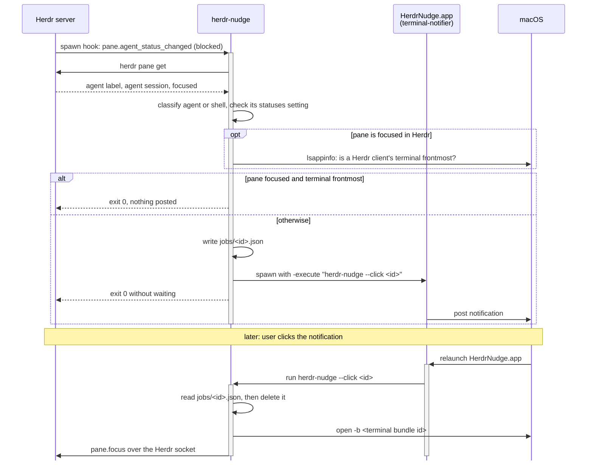

# Herdr Nudge

[](https://github.com/justinchiasson/herdr-nudge/actions/workflows/ci.yml)
[](https://github.com/justinchiasson/herdr-nudge/releases/latest)
[](LICENSE)

Clickable Mac notifications for [Herdr](https://herdr.dev). Get notified when
an agent needs you or a long command finishes, then click the notification to
jump straight to that pane.


```sh
herdr plugin install justinchiasson/herdr-nudge
```

Requires macOS (Apple Silicon or Intel) and Herdr 0.9.0 or later. There's
nothing else to install. To update later, run
`herdr plugin update herdr-nudge`.

[What it does](#what-it-does) · [Install](#install) · [Update](#update) ·
[Shell commands](#long-shell-commands-optional-zsh) · [Commands](#commands) ·
[Settings](#settings) · [FAQ](#faq) · [Troubleshooting](#troubleshooting) ·
[How it works](#how-it-works)

## What it does

- Get notified when an agent is waiting for your input (`blocked`) or has
  finished (`done`). This works with Claude Code, Codex, Gemini, Cursor and
  every other agent Herdr detects, and the notification shows the agent's
  logo.
- Get notified when a long shell command finishes, with whether it passed or
  failed and how long it took. "Long" means 5 seconds or more by default.
  This needs a quick [zsh setup](#long-shell-commands-optional-zsh).
- Click a notification to go straight to that pane, even if it's in another
  workspace or tab. Your terminal comes to the front too.
- You won't be notified about a pane you're already looking at.
- Notifications clear themselves once they're out of date, like when the
  agent starts working again, you run another command, or you close the pane,
  tab or workspace. On Herdr 0.9.1 and later, they also clear when you switch
  to that pane yourself.

| A test fails while you're in your editor | Click the notification to jump to the pane |
|---|---|
|  |  |

## Install

1. Install the plugin:

   ```sh
   herdr plugin install justinchiasson/herdr-nudge
   ```

   Herdr will ask you to confirm before it installs.
2. Allow notifications. The first time Herdr Nudge sends a notification,
   macOS will ask for permission. Click **Allow**.

That's all you need for agent notifications. To try it out, give an agent a
task, switch to another app, and wait for it to finish or ask you something.

If you also want notifications for long shell commands, set up the
[zsh hook](#long-shell-commands-optional-zsh).

### Update

```sh
herdr plugin update herdr-nudge
```

`herdr plugin update` was added in Herdr 0.9.4. On older versions, run the
install command again instead.

If you use the zsh hook, restart Herdr after updating and open a new pane, so
your shell picks up the new version of the hook:

```sh
herdr server stop
herdr
```

### Uninstall

```sh
herdr plugin uninstall herdr-nudge
```

If you set up the zsh hook, also remove its lines from your `.zshrc`.

### Keep notifications on screen

By default, notifications disappear after a few seconds and stay in
Notification Center for an hour. If you'd like them to stay on screen until
you dismiss them, go to System Settings > Notifications > Herdr Nudge and set
the alert style to *Persistent* (*Alerts* on older macOS).

## Long shell commands (optional, zsh)

Herdr tells plugins when an agent changes status, but it doesn't keep track of
plain shell commands. A small zsh hook fills that gap. To set it up:

1. Run the plugin's `setup-zsh` command, which adds three lines to your
   `.zshrc`:

   ```sh
   ~/.config/herdr/plugins/github*/herdr-nudge-*/**/bin/herdr-nudge(om[1]) setup-zsh
   ```

   That long path points to the plugin's folder, which Herdr manages
   ([why it looks like this](#herdr-nudges-own-commands)).
2. Restart Herdr once, so the plugin can create the file those lines load.
   `setup-zsh` will tell you if you need to.

   ```sh
   herdr server stop
   herdr
   ```
3. Open a new pane. The hook only loads in new shells, so panes that were
   already open won't have it.

To test it, run `sleep 6` in the new pane and switch to another app. You
should get a notification when it finishes.

### Which shell commands notify

The hook notifies for any command that runs for 5 seconds or longer, except
for:

- Programs that keep running until you quit them, like editors, pagers, `ssh`
  and `tmux`. The full list is the `ignore_commands` setting in
  [Settings](#settings).
- AI agents, even if you start them with an alias. You already get agent
  notifications when they're blocked or done, so the hook leaves them out.
- Commands run outside Herdr. The hook only does anything inside a Herdr pane.

To change the 5-second threshold, set `min_seconds` in your
[settings file](#settings) and restart Herdr:

```toml
[shell]
min_seconds = 10
```

### Adding the lines yourself

If you'd rather edit your `.zshrc` by hand (or `$ZDOTDIR/.zshrc` if you've set
`ZDOTDIR`), these are the lines `setup-zsh` adds:

```zsh
if [[ -r ~/.local/state/herdr/plugins/herdr-nudge/herdr-nudge.zsh ]]; then
  source ~/.local/state/herdr/plugins/herdr-nudge/herdr-nudge.zsh
fi
```

## Commands

### Herdr commands

| What you want to do | Command |
|---|---|
| Install | `herdr plugin install justinchiasson/herdr-nudge` |
| Update (Herdr 0.9.4 and later) | `herdr plugin update herdr-nudge` |
| Uninstall | `herdr plugin uninstall herdr-nudge` |
| Find the settings folder | `herdr plugin config-dir herdr-nudge` |
| See recent plugin activity | `herdr plugin log list --plugin herdr-nudge --limit 20` |
| Restart Herdr | `herdr server stop`, then `herdr` |

### Herdr Nudge's own commands

Herdr Nudge also has a few commands of its own for checking your setup and
trying things out. You won't need them day to day.

The plugin isn't on your `PATH`, and on Herdr 0.9.4 and later its folder
changes every time it updates. So you run it through this path, which always
finds the latest version. It works in zsh, the default shell on macOS:

```sh
~/.config/herdr/plugins/github*/herdr-nudge-*/**/bin/herdr-nudge(om[1]) doctor
```

If you use these often, add an alias to your `.zshrc` so you can just type
`herdr-nudge doctor`:

```sh
alias herdr-nudge='~/.config/herdr/plugins/github*/herdr-nudge-*/**/bin/herdr-nudge(om[1])'
```

| Command | What it does |
|---|---|
| `doctor` | Checks for anything that would stop notifications from working: problems in your settings file, `[agents] ignore` entries that don't match any agent, macOS notification permission and alert style, Herdr's own desktop notifications being on (which would give you duplicates), and whether your `.zshrc` loads the hook. Exits with status 1 if something is broken. |
| `test` | Sends a sample agent notification for the pane you run it in. Switch to another app, then click the notification to see it bring you back. `test --shell` sends a sample shell-command notification instead. Run it inside a Herdr pane. |
| `example-config` | Creates a `config.toml` with every setting at its default value and a comment explaining each one. If you already have a `config.toml`, it prints the example instead and leaves your file alone. |
| `setup-zsh` | Adds the [zsh hook](#long-shell-commands-optional-zsh) to your `.zshrc`, after showing you the lines and asking first. Does nothing if they're already there. |

In the plugin log you might also see it run with `--cleanup`, `--click` or no
arguments. That's Herdr and macOS running it when Herdr starts, on each event,
and when you click a notification. You never need to run those yourself.

## Settings

Herdr Nudge works out of the box, with no configuration needed. If you want to
change something, create a `config.toml` file in the plugin's settings folder.
To find that folder, run:

```sh
herdr plugin config-dir herdr-nudge
```

The easiest way to start is with [`example-config`](#herdr-nudges-own-commands),
which creates the file with every setting and a comment for each. Then delete
the ones you don't want to change. Here's what a small settings file looks
like:

```toml
[notifications]
sound = true

[agents]
ignore = ["codex"]

[shell]
min_seconds = 10
notify_on_failure_only = true
```

Most changes take effect with the next notification. The exceptions are the
settings the zsh hook uses: `[shell]` `enabled`, `min_seconds`,
`ignore_commands` and the two `known_agents` lists. The hook only reads those
when Herdr starts, so restart Herdr after changing them.

If the file contains a setting the plugin doesn't recognize, like a typo, the
plugin ignores the whole file and uses the defaults until you fix it.
[`doctor`](#herdr-nudges-own-commands) will show you which line is wrong.

### All settings

**Top level** (put these above any `[section]`)

| Setting | Default | Description |
|---|---|---|
| `default_terminal` | not set | The bundle ID of the app to bring forward when you click a notification, like `"com.mitchellh.ghostty"`. If it's not set, Herdr Nudge uses the terminal Herdr is running in. You only need this if clicking [opens the wrong app](#clicking-a-notification-opens-the-wrong-window-tab-or-app). |

**`[notifications]`**

| Setting | Default | Description |
|---|---|---|
| `clickable_secs` | `3600` | How long, in seconds, a notification can still be clicked in Notification Center. |
| `sound` | `false` | Set to `true` to also play the macOS notification sound. See [About sound](#about-sound). |
| `agent_logos` | `true` | Show the agent's logo on the right side of the notification. |
| `show_workspace` | `true` | Show the workspace name under the title. |

**`[agents]`**

| Setting | Default | Description |
|---|---|---|
| `enabled` | `true` | Turns agent notifications on or off. |
| `statuses` | `["blocked", "done"]` | Which agent statuses send a notification. Can include `idle`, `working`, `blocked` and `done`. |
| `ignore` | `[]` | Agents you don't want notifications for, by Herdr's label for them (`"codex"`, not `"Codex"`). |

**`[shell]`**

| Setting | Default | Description |
|---|---|---|
| `enabled` | `true` | Turns shell command notifications on or off. |
| `min_seconds` | `5` | How long a command has to run, in seconds, before it sends a notification. |
| `statuses` | `["idle", "done"]` | Which statuses send a notification. When a command finishes, Herdr reports it as `idle`, or as `done` if you weren't looking at the pane, so both are included. |
| `notify_on_failure_only` | `false` | Only notify when a command fails. |
| `ignore_commands` | see below | Commands that never send a notification. These match on the command name only, so `"git"` would silence every git command. |
| `known_agents_extra` | `[]` | Extra labels to treat as AI agents instead of shell commands. Agents Herdr already knows about don't need to be listed. |
| `known_agents_remove` | `[]` | Labels to treat as shell commands, even if Herdr says they're agents. |

Setting a list replaces the default list entirely. So to add a command to
`ignore_commands`, copy the default list and add yours to the end, like
`watch` here:

```toml
[shell]
ignore_commands = ["vim", "vi", "nvim", "emacs", "nano", "less", "more", "man",
  "ssh", "mosh", "tmux", "screen", "zellij", "top", "htop", "btop", "lazygit",
  "tig", "fzf", "watch"]
```

### About sound

Notification sounds come from Herdr, which plays one when an agent is blocked
or done, or a long command finishes. Herdr Nudge's `sound` setting is off by
default so you don't get two sounds at once.

To change or mute the sound, use `[ui.sound]` in Herdr's own config
(`~/.config/herdr/config.toml`).

If you also want the standard macOS notification sound, set `sound = true`
under `[notifications]` in Herdr Nudge's [settings file](#settings).

## FAQ

### How is this different from Herdr's own notifications?

Herdr can show its own desktop notifications if you turn them on in its
settings, but clicking one of those only brings your terminal to the front.
Clicking a Herdr Nudge notification also switches Herdr to the right pane,
even if it's in a different workspace or tab. If you have both turned on,
you'll get two notifications for everything, so it's best to
[turn Herdr's off](#every-notification-shows-up-twice).

### Which agents does it work with?

Any agent Herdr can detect, including Claude Code, Codex, Gemini, Cursor, Kilo
and Grok. The notification shows the agent's logo, which you can turn off with
`agent_logos = false` in [Settings](#settings).

### Which terminals does it work with?

I've tested it with Ghostty. Clicking a notification brings forward whichever
app Herdr is running in, so other Mac terminals should work too. If clicking
opens the wrong app, see
[this fix](#clicking-a-notification-opens-the-wrong-window-tab-or-app).

### Do I have to use zsh?

Only for shell command notifications. Agent notifications work with any shell.

### Do I need to install anything else?

No. Notifications are sent through
[terminal-notifier](https://github.com/julienXX/terminal-notifier), which comes
bundled inside the plugin as an app called Herdr Nudge and runs on both Apple
Silicon and Intel Macs. The only other thing you need is `git`, which Herdr
uses to install plugins. If macOS asks to install the Command Line Tools, say
yes.

### Can I change what I get notified about?

Yes. You can change how long a command has to run, which statuses notify, the
sound, the logos and more. See [Settings](#settings).

### Why didn't I get a notification for the pane I was looking at?

That's intentional. If the pane is focused in Herdr and your terminal is the
app in front, you're already looking at it, so there's no need to notify you.
Switch to a different pane or app and you'll get notified.

### Does it send anything over the network?

No. It only talks to Herdr and to macOS's notification system.

### Does it change anything on my Mac?

Very little. After each install or update, it registers its notification app
with macOS, the same thing that happens when you open an app from Finder. Some
Macs won't ask for notification permission until that's done. It registers
again whenever Herdr starts and when you run
[`doctor`](#herdr-nudges-own-commands). Everything else it creates, including
the zsh hook, lives in Herdr's folder for plugin data. It only edits your
`.zshrc` if you run [`setup-zsh`](#long-shell-commands-optional-zsh) and say
yes.

### Does it slow Herdr down?

No. Herdr doesn't wait for plugins to finish, and Herdr Nudge handles each
event in well under a second.

### Does it work on Linux or Windows?

No, it's macOS only.

## Troubleshooting

Start by running `doctor`. It checks for most of the problems below and tells
you how to fix them:

```sh
~/.config/herdr/plugins/github*/herdr-nudge-*/**/bin/herdr-nudge(om[1]) doctor
```

### No notifications at all

- Make sure notifications are allowed in System Settings > Notifications >
  Herdr Nudge.
- Check that a Focus mode, like Do Not Disturb, isn't on.
- macOS hides notifications while you're sharing or recording your screen,
  unless "Allow notifications when mirroring or sharing the display" is turned
  on in System Settings > Notifications.
- You won't get notified about the pane you're currently looking at
  ([why](#why-didnt-i-get-a-notification-for-the-pane-i-was-looking-at)).

### Agent notifications work, but shell commands don't

- Make sure you did all three
  [setup steps](#long-shell-commands-optional-zsh): added the lines to
  `.zshrc`, restarted Herdr, and opened a new pane.
  [`doctor`](#herdr-nudges-own-commands) checks the first two.
- The command has to run for at least `min_seconds` (5 by default).
- Commands in `ignore_commands` (editors, pagers, `ssh` and so on) never
  notify. And if `notify_on_failure_only` is on, only failed commands do.

### I got a notification for `git commit`, or another command that was waiting on me

The hook times the whole command, including the time your editor was open. If
that's longer than 5 seconds, you get a notification. To stop it, raise
`min_seconds` or add the command to `ignore_commands`. Keep in mind that
`ignore_commands` matches on the command name only, so adding `"git"` silences
every git command.

### Every notification shows up twice

That means Herdr's own desktop notifications are turned on too (they're off
by default). To turn them off, open `~/.config/herdr/config.toml` and set
`delivery` under `[ui.toast]` to `"herdr"` (show them inside Herdr only) or
`"off"`:

```toml
[ui.toast]
delivery = "herdr"
```

Then reload Herdr's settings:

```sh
herdr server reload-config
```

### Clicking a notification opens the wrong window, tab or app

Herdr Nudge can bring your terminal app to the front, but it can't pick a
specific window or tab yet. macOS brings forward the window you used most
recently, showing whichever tab was already open there.

If it opens the wrong app entirely, set `default_terminal` in your settings to
your terminal's bundle ID. You can look it up with this command (replace
Ghostty with your terminal's name):

```sh
osascript -e 'id of app "Ghostty"'
```

### Clicking a notification does nothing

The notification is probably more than an hour old. Notifications can only be
clicked for `clickable_secs` seconds, which is one hour by default.

### Notifications disappear too quickly

Go to System Settings > Notifications > Herdr Nudge and set the alert style to
*Persistent*.

### My settings don't do anything

- If the file has a setting the plugin doesn't recognize, like a typo, the
  whole file is ignored. [`doctor`](#herdr-nudges-own-commands) shows you
  which line is the problem.
- The zsh hook's settings only take effect after you restart Herdr.
- `default_terminal` has to go above the first `[section]` in the file.

### Still stuck?

[Open an issue](https://github.com/justinchiasson/herdr-nudge/issues/new) and
include the output of these commands:

```sh
~/.config/herdr/plugins/github*/herdr-nudge-*/**/bin/herdr-nudge(om[1]) doctor
herdr --version
herdr plugin log list --plugin herdr-nudge --limit 20
```

## Known limits

- If you go back to a pane by switching to your terminal, and that pane was
  already selected in Herdr, its `done` notification stays up. Herdr doesn't
  tell plugins when that happens. The notification still goes away when you
  click it, when the agent starts working again, when you run another command
  in that pane, or after an hour.
- Clicking a notification brings your terminal app to the front, but not
  necessarily the window or tab Herdr is running in. If you have several
  windows, macOS brings forward the one you used last. If you have several
  tabs, the current tab stays selected.
- If you move a pane to a different workspace, any notification it already had
  won't clear on its own.
- If you use a different plugin to report shell commands (like herdr-ohmyzsh)
  instead of Herdr Nudge's zsh hook, then on Herdr 0.9.2 and later a command's
  notification won't clear when you run the next command. It still clears
  when you click it, switch to its pane, or after an hour.

## How it works

Herdr Nudge is a small Rust program that Herdr runs as a plugin hook. Herdr
runs it whenever an agent's status changes, a pane gets focus, or a pane, tab
or workspace closes. It handles that one event and exits, so nothing runs in
the background.

Notifications are posted by
[terminal-notifier](https://github.com/julienXX/terminal-notifier), bundled in
the plugin as its own app, `HerdrNudge.app`, so it has its own name, icon and
entry in System Settings. terminal-notifier's `-execute` option attaches a
command to a notification, and macOS runs it when the notification is clicked.
That's how a click gets back to Herdr Nudge, long after the hook has exited.



Step by step:

1. Herdr runs `herdr-nudge` with the event. It first checks whether your
   settings care about this status at all, so the frequent `working` updates
   from a busy agent are dropped right away.
2. If they do, it runs `herdr pane get`, uses the result to classify the pane
   as an agent or a shell command, and checks that kind's `statuses` setting.
   If the pane is focused in Herdr, it also asks `lsappinfo` whether a Herdr
   client's terminal is the frontmost app. If both are true, you're already
   looking at the pane, so it stops there.
3. Otherwise it writes a job file, `jobs/<id>.json`, and starts
   `HerdrNudge.app` to post the notification, with `herdr-nudge --click <id>`
   as its `-execute` command. The hook exits without waiting for the
   notification to appear.
4. When you click the notification, macOS relaunches `HerdrNudge.app`, which
   runs `herdr-nudge --click <id>`. That process
   starts with a minimal environment and no `HERDR_*` variables, so it reads
   Herdr's socket path and the pane ID from the job file. It looks up which
   terminal Herdr is running in again (falling back to the one saved in the
   job), brings it to the front with `open -b`, then sends `pane.focus` over
   Herdr's socket.
5. Every later event also checks which notifications are still showing, and
   removes any that are out of date.

### Design notes

- Text from panes, like titles, agent names and command lines, never gets
  passed to a shell. The only command attached to a notification is Herdr
  Nudge's own path plus a 16-character hex ID, and that ID is validated before
  it's used.
- Herdr doesn't wait for hooks to finish, and it can run several at once for
  the same pane. So the hook never waits on the notifier, and state files are
  written to a temporary file first and then renamed into place, so another
  hook never reads a half-written file.
- `herdr plugin install` just does a `git fetch` with no build step, so the
  repo includes a prebuilt universal binary (Intel and Apple Silicon) in
  `bin/`. CI runs the tests on both architectures, runs both halves of the
  binary, and checks that it was built from the committed source.
- The tests replay events, CLI output and socket replies captured from a real
  Herdr, from more than one Herdr version. None of the test data is written by
  hand. It's all in `tests/fixtures/`.
- It's written in Rust with only three dependencies (`serde`, `serde_json` and
  `toml`), no async runtime, and `unsafe` code is forbidden.

## Development

You'll need Rust 1.88 or later. To run the tests:

```sh
cargo test
```

Herdr runs the prebuilt binary in `bin/`, not the one in `target/`. So after
changing the code, rebuild it and commit the new binary along with your
change. Building it needs both Rust targets installed:

```sh
rustup target add x86_64-apple-darwin aarch64-apple-darwin   # only needed once
tools/build-bin.sh
```

To run your local copy in Herdr, link it with `herdr plugin link .`. Herdr
reads `herdr-plugin.toml` when you link the plugin, so link it again after
changing that file. After a Herdr upgrade, see `tests/fixtures/README.md` for
how to check what changed.

| Folder | What's in it |
|---|---|
| `src/` | The plugin's source. One binary handles events, clicks and all the commands above. |
| `shell/herdr-nudge.zsh` | The zsh hook. |
| `tests/fixtures/` | Real Herdr events and responses that the tests replay. |
| `vendor/HerdrNudge.app` | terminal-notifier 3.1.0, renamed and given its own icon. |
| `bin/` | The prebuilt universal binary. |
| `tools/` | Scripts for building, capturing test data, and live testing. |

## License

MIT. See [LICENSE](LICENSE).
[terminal-notifier](https://github.com/julienXX/terminal-notifier) is also MIT
licensed, and its license is in
[vendor/terminal-notifier-LICENSE.md](vendor/terminal-notifier-LICENSE.md).

The Herdr logo and the agent logos belong to their owners. This plugin isn't
affiliated with Herdr or any of the agent makers. [NOTICE.md](NOTICE.md) lists
where each logo came from.
